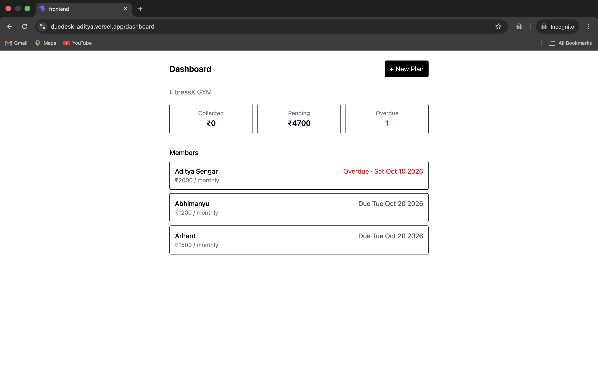
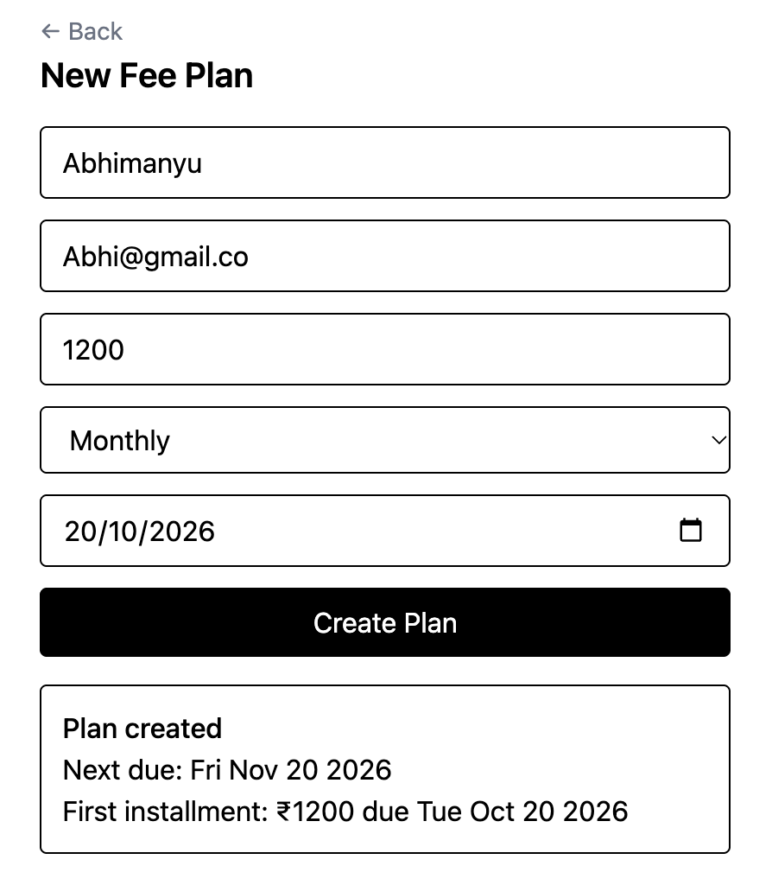
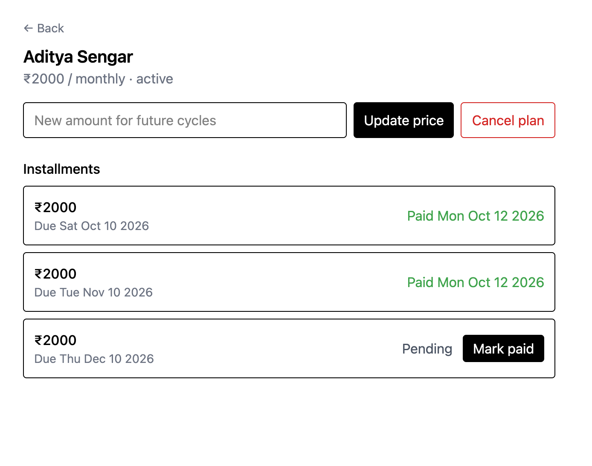
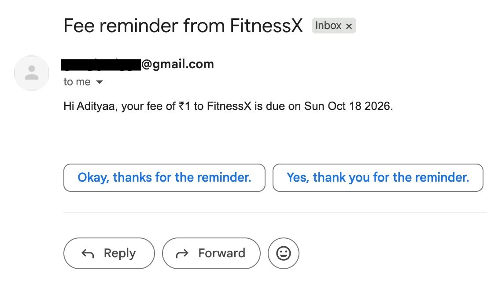

# DueDesk

**Live demo: https://duedesk-aditya.vercel.app**

> The backend runs on a free tier and sleeps when idle, so the first load can take up to a minute.

Recurring fee tracking for small service businesses (gyms, tuition centers, coaching institutes). Owners put members on subscription plans, mark payments as they come in, and members get email reminders before each due date. It replaces the notebook, Excel sheet, or WhatsApp thread most of these businesses use today.

## Screenshots

| New plan | Dashboard |
|---|---|
|  |  |
 
| Plan detail | Reminder email |
|---|---|
|  |  |
## Features

- Google sign-in for the business owner
- Add a member and their recurring plan in one form (amount, weekly or monthly, start date)
- Dashboard with total collected, total pending, and overdue count, plus a list of members and their next due date
- Plan detail page with every installment, a Mark paid button, a price update, and plan cancellation
- Marking an installment paid generates the next billing cycle automatically
- Price changes apply to future cycles only; already-issued installments keep their amount
- Email reminders 7 days and 2 days before each due date, naming the amount, due date, and the business
- Per-owner data isolation: an owner can only read or change their own members and plans

**Planned:** WhatsApp and SMS reminders, member-facing view, payment gateway integration.

## Tech stack

- **Frontend:** React, Vite, Tailwind CSS, React Router
- **Backend:** Node.js, Express
- **Database:** MongoDB (Mongoose)
- **Auth:** Google Sign-In, verified on the server, then a JWT issued by the app
- **Reminders:** node-cron + Nodemailer (Gmail SMTP)
- **Hosting:** Vercel (frontend), Render (backend)

## How it works

1. The owner signs in with Google. The frontend sends Google's ID token to the backend, which verifies it with Google, finds or creates the owner, and returns its own JWT.
2. Every other request carries that JWT. The `requireAuth` middleware verifies it and sets `req.ownerId`, so routes never trust an owner ID sent by the client.
3. Creating a plan stores the plan and its first installment. Marking an installment paid creates the next one at the plan's current price and moves the plan's `nextDueDate` forward.
4. A daily job at 9:00 AM IST finds pending installments due in exactly 7 or 2 days, emails the member, and stamps the installment so the same reminder is never sent twice.

## Data model

- **Owner:** googleId, name, email, businessName
- **Member:** ownerId, name, email
- **FeePlan:** ownerId, memberId, amount, frequency, nextDueDate, status (`active` / `cancelled`)
- **Installment:** feePlanId, amount, dueDate, status, paidAt, reminder7dSentAt, reminder2dSentAt

## Design decisions

**Subscription plans.** Gym and tuition fees works in a way where: memberships renew until someone cancels.

**Email first.** It's free and needs no approval. WhatsApp requires Meta business verification and pre-approved message templates for business-initiated messages. SMS costs per message and, in India, requires DLT registration. Email delivery lives behind one `sendEmail` function, so another channel is a change to that function and not to the scheduling logic.

**Ownership comes from the token, never from the request body.** Routes read `req.ownerId` from the verified JWT. Installments don't store an owner, so installment routes check ownership through the parent plan before changing anything.

**Reminder with sent-at fields.** Each installment records when its 7-day and 2-day reminders went out. A failed send leaves the field empty, so the next run retries it, and a successful send is never repeated.

## API

All routes except login require `Authorization: Bearer <token>`.

| Method | Route | Purpose |
|---|---|---|
| POST | `/api/auth/google` | Verify Google ID token, return app JWT |
| PATCH | `/api/me` | Set business name |
| GET | `/api/dashboard` | Totals and member list |
| POST | `/api/members` | Create member |
| POST | `/api/feeplans` | Create plan and first installment |
| GET | `/api/feeplans/:id` | Plan with its installments |
| PATCH | `/api/feeplans/:id` | Change price or cancel |
| PATCH | `/api/installments/:id` | Mark paid or pending; paid generates the next cycle |

## Running locally

```bash
# backend
cd Backend
npm install
npm run dev   # or: node server.js

# frontend
cd Frontend
npm install
npm run dev
```

**Backend `.env`**
```
MONGO_URI=
JWT_SECRET=
GOOGLE_CLIENT_ID=
EMAIL_USER=
EMAIL_PASS=        # Gmail app password, not your account password
FRONTEND_URL=      # optional locally; restricts CORS in production
```

**Frontend `.env`**
```
VITE_API_URL=http://localhost:3000
VITE_GOOGLE_CLIENT_ID=
```

## Known limitations

- Payments are marked manually; there is no payment gateway yet.
- Reminders are email only.
- The reminder job runs inside the web server, so the free-tier host needs a keep-alive ping to stay awake at 9 AM.
- Single owner role: members don't log in.
